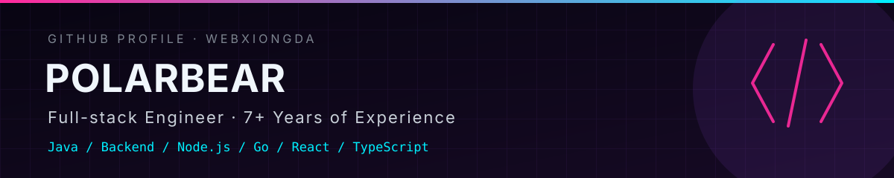

  

  <strong>高级前端工程师 · 7 年+ 经验</strong> 
  React · TypeScript · Vue 3 · Taro · Node.js · Java / Spring Boot

  <a href="#精选项目">精选项目</a> ·
  <a href="#技术栈">技术栈</a> ·
  <a href="#白熊数字科技">产品线</a> ·
  <a href="#关于">关于</a> ·
  <a href="#联系">联系</a>

---

## 精选项目

| 项目 | 简介 | 技术栈 |
| --- | --- | --- |
| [**java-study**](https://github.com/webxiongda/java-study) | Java 系统化学习与在线闯关平台：章节进度、面试题库、答题判分，含完整 CI/CD | Spring Boot · MySQL · Vue 3 |
| [**python-learning**](https://github.com/webxiongda/python-learning) | Python 全栈学习平台：认证、课程、题库与代码质量门禁 | FastAPI · SQLAlchemy · GitHub Actions |
| [**xiong-terminal-setup**](https://github.com/webxiongda/xiong-terminal-setup) | macOS 终端与开发环境一键配置工具链，开箱即用的 Zsh / Tmux / Starship 方案 | Shell · Zsh · Tmux |
| [**yokexiong-blog**](https://github.com/webxiongda/yokexiong-blog) | 基于 Next.js 与 Notion API 的个人技术博客，支持中英文与增量渲染 | Next.js · TypeScript · Notion API |

## 技术栈

  
  
  
  
  
  

  
  
  
  
  

## 白熊数字科技

面向商家的小程序产品线，覆盖 **美业预约 / 餐饮点单 / 家政接单 / 零售商城**：
会员储值、排班收银、多门店与双端接单等完整业务链路。

> 商业项目源码、二次开发与授权合作，欢迎通过下方方式联系洽谈。

## 关于

- 7 年+ 前端开发经验，主攻 **多端合一**（Web / H5 / 小程序）与 **复杂中后台**
- 有 Java / Node.js 全栈落地经验，习惯用工程化与自动化保障交付质量
- 持续探索 AI 提效：把重复劳动沉淀为可复用的工具与工作流

## 联系

- 在任意公开仓库提 [Issue](https://github.com/webxiongda/java-study/issues) 是最快的联系方式
- 关注 [GitHub 主页](https://github.com/webxiongda) 查看最新开源动态

---

  如果这些项目对你有帮助，欢迎点一个 Star ⭐

